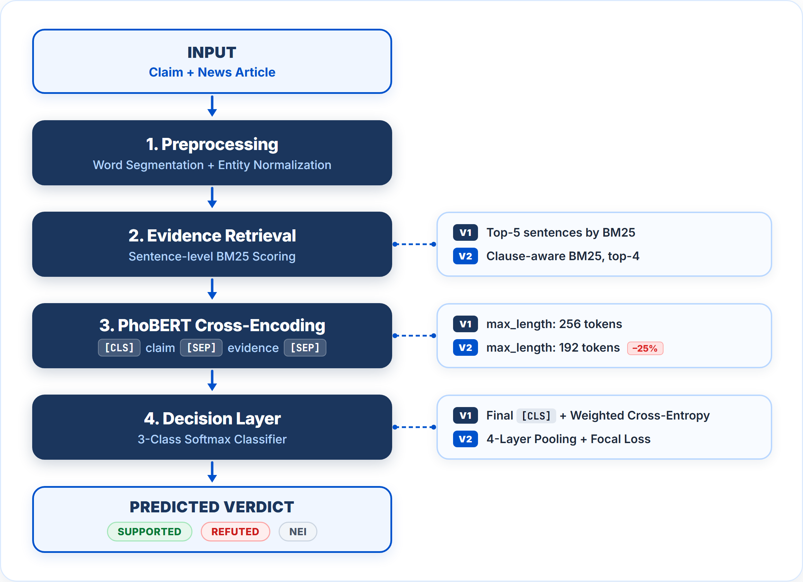

# Configuration-Level Analysis of PhoBERT for Vietnamese Economic and Business Fact Verification: Performance and Computational Cost

[](https://stais.org)
[](docs/STAIS2026_Best_Paper_Certificate.pdf)
[](https://www.python.org/)
[](https://pytorch.org/)
[](https://huggingface.co/)
[](LICENSE)

Official repository for the paper: **"Configuration-Level Analysis of PhoBERT for Vietnamese Economic and Business Fact Verification: Performance and Computational Cost"**, presented at the **Symposium on Technology & AI Systems (STAIS 2026)** and recipient of the **Best Paper Award 🏆**.

---

## 📌 Abstract

Vietnamese fact verification in economic and business news requires both accurate handling of numerical and temporal details and practical computational cost. This study compares a performance-oriented **PhoBERT reference configuration (v1)** with an **efficiency-oriented configuration (v2)** on 682 claim-evidence pairs from the economics and business portion of ViFactCheck. 

* The reference configuration (**v1**) reaches **Macro F1 = 0.738** and **Accuracy = 0.738** (88.7% accuracy on numerically rich claims).
* The efficiency configuration (**v2**) achieves **Macro F1 = 0.594 ± 0.019** and **Accuracy = 0.610**.
* In return, **v2 reduces GPU pipeline execution time by ~40.0%**, **peak VRAM by 43.2%** (from 10.4 GB to 5.9 GB), and **per-sample inference latency by 38.8%** on an NVIDIA Tesla T4 GPU.

A configuration-level ablation analysis groups the simultaneous changes into input compression, evidence selection, training objectives, representation pooling, augmentation, and post-hoc calibration, framing the trade-offs between predictive safety and resource efficiency for edge and production deployments.

---

## 👥 Authors & Affiliation

* **Dao Ngoc Hong Nguyen**¹ (First Author & Presenter)
* **Trang Thao Ngo**¹
* **Tran Duy Bao Nguyen**¹
* **Dr. Ha Thanh Nguyen**² (Corresponding Advisor)
* **Dr. Thuan Dinh Dang**² (Corresponding Advisor)

¹ *Undergraduate Researchers, Faculty of Data Science in Business, Ho Chi Minh University of Banking (HUB), Vietnam*  
² *Faculty of Data Science in Business, Ho Chi Minh University of Banking (HUB), Vietnam*

---

## 🏛️ Pipeline Architecture



The complete two-stage verification pipeline consists of:
1. **Evidence Retrieval:** Clause-aware BM25 search over relevant economic articles to retrieve top candidate evidence sentences.
2. **Claim Verification (PhoBERT Backbone):** A fine-tuned transformer predicting three verdict classes: `SUPPORTED`, `REFUTED`, or `NOT ENOUGH INFO (NEI)`.

---

## ⚙️ Configuration Comparison: Reference (v1) vs. Efficiency (v2)

| Component | Reference Configuration (v1) | Efficiency Configuration (v2) | Change Group |
| :--- | :--- | :--- | :--- |
| **Backbone** | `vinai/phobert-base` | `vinai/phobert-base` | Unchanged |
| **Max Sequence Length** | 256 tokens | 192 tokens | Input compression |
| **Evidence Selection** | BM25 Top-5 | Clause-aware BM25 Top-4 | Retrieval |
| **Batch Size / Acc.** | 8 / 1 | 16 / 2 | Training schedule |
| **Learning Rate** | $3 \times 10^{-5}$ | $2 \times 10^{-5}$ | Training schedule |
| **Loss Function** | Weighted Cross-Entropy | Focal Loss ($\gamma = 2.0$) + Label Smoothing ($\epsilon = 0.1$) | Objective |
| **Representation Head** | Final-layer `[CLS]` | Weighted 4-Layer Pooling + 5-Dropout Average | Representation |
| **Data Augmentation** | None | 378 Sub-claim swapped examples (ClaimDecomposer) | Data expansion |
| **Post-hoc Calibration** | None | Exploratory entropy-based NEI reassignment | Calibration |

---

## 📊 Benchmark Results

### 1. Predictive Performance (141-instance test set)

| Metric | Reference (v1) | Efficiency (v2) | Difference ($\Delta$) |
| :--- | :---: | :---: | :---: |
| **SUPPORTED F1** | 0.760 | 0.680 | -0.080 |
| **REFUTED F1** | 0.690 | 0.560 | -0.130 |
| **NEI F1** | 0.760 | 0.580 | -0.180 |
| **Macro F1** | **0.738** | 0.594 ± 0.019 | **-0.144** |
| **Accuracy** | **0.738** (104/141) | 0.610 (86/141) | **-0.128** |
| **Numerically Rich Accuracy** | **88.7%** (63/71) | 59.2% (42/71) | **-29.5%** |

### 2. Computational Cost & Resource Profiling (NVIDIA Tesla T4 16GB)

| Metric | Reference (v1) | Efficiency (v2) | Resource Reduction |
| :--- | :---: | :---: | :---: |
| **Total Pipeline (CPU)** | ~51 min | ~32 min | **▼ 37.2%** |
| **Total Pipeline (GPU, T4)** | ~15.0 min | ~9.0 min | **▼ 40.0%** |
| **Peak VRAM** | 10.4 GB | 5.9 GB | **▼ 43.2%** |
| **Inference Latency / Sample** | 0.85 s | 0.52 s | **▼ 38.8%** |

> **Theoretical Insight:** Shortening context from $L=256$ to $L=192$ yields a quadratic attention scaling ratio $(192/256)^2 = 0.5625$ (an expected 43.75% memory drop), matching the empirically recorded **43.2% VRAM reduction**.

---

## 📂 Repository Structure

```text
STAIS2026_PhoBERT_FactCheck/
├── README.md                              # Main documentation & empirical overview
├── requirements.txt                       # Python dependencies
├── LICENSE                                # MIT Open Source License
├── .gitignore                             # Ignored checkpoints and cache files
├── notebooks/
│   ├── vifactcheck_v1_reference.ipynb     # v1 Reference (High-Accuracy Model)
│   └── vifactcheck_v2_optimized.ipynb     # v2 Efficiency (Resource-Optimized Model)
├── docs/
│   ├── STAIS2026_Paper_Manuscript.docx    # Full paper manuscript
│   ├── STAIS2026_Presentation_Slides.pptx # Official conference presentation slides
│   ├── STAIS2026_Presentation_Slides.pdf  # PDF slides version
│   ├── STAIS2026_Presentation_Script_EN.docx # Presentation oral script (English)
│   ├── STAIS2026_Presentation_Script_Bilingual.pdf # Script with phonetic notes & vocabulary
│   └── STAIS2026_Response_to_Reviewers.docx  # Response to conference reviewers
└── figures/
    ├── fact_checking_pipeline_diagram.png # High-res end-to-end architecture
    ├── pipeline_diagram_en.png            # Detailed module diagram
    ├── pipeline_flowchart_en.png          # Decision flow diagram
    └── flowchart_cascade_algorithm.png    # Clause-aware retrieval logic
```

---

## 🚀 Quickstart & Reproduction

### 1. Clone & Setup Environment
```bash
git clone https://github.com/your-username/STAIS2026_PhoBERT_FactCheck.git
cd STAIS2026_PhoBERT_FactCheck

# Create virtual environment
python -m venv venv
source venv/bin/activate  # On Windows: venv\Scripts\activate

# Install dependencies
pip install -r requirements.txt
```

### 2. Dataset
The experiments use the economic & business domain subset of **ViFactCheck**, automatically fetched via Hugging Face Datasets:
```python
from datasets import load_dataset
dataset = load_dataset("tranthaihoa/vifactcheck")
```

### 3. Run Notebooks
* **Run Reference Configuration (v1):** Open `notebooks/vifactcheck_v1_reference.ipynb`
* **Run Efficiency-Oriented Configuration (v2):** Open `notebooks/vifactcheck_v2_optimized.ipynb`

Both notebooks can be run directly on local GPU environments or uploaded to **Google Colab** (with a free T4 GPU runtime).

---

## 📜 Citation

If you use this repository, the models, or findings in your academic or applied research, please cite our paper:

```bibtex
@inproceedings{nguyen2026phobert,
  title={Configuration-Level Analysis of PhoBERT for Vietnamese Economic and Business Fact Verification: Performance and Computational Cost},
  author={Nguyen, Dao Ngoc Hong and Ngo, Trang Thao and Nguyen, Tran Duy Bao and Nguyen, Ha Thanh and Dang, Thuan Dinh},
  booktitle={Proceedings of the Symposium on Technology and AI Systems (STAIS 2026)},
  year={2026},
  note={Best Paper Award}
}
```

---
*For inquiries or collaboration, please reach out via GitHub Issues or contact the authors through Ho Chi Minh University of Banking.*
